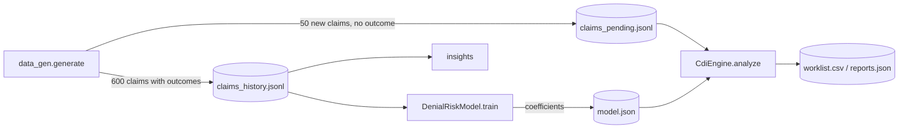
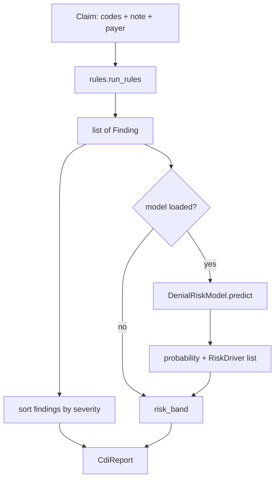

# CDI Engine POC – Workflow and Code Guide

This document explains what the Clinical Documentation Improvement (CDI) proof of concept does, how a claim flows through it, and what each module, class and function is for. For setup and commands, see [README.md](README.md).

---

## 1. Purpose

Insurers reject claims when the clinical documentation doesn't support what was billed. Many of these rejections can be prevented, and so can lost revenue from codes that are less specific than the documentation allows. The CDI engine reviews a claim **before it is submitted** and tells the clinician or billing team:

| Output | Example |
|---|---|
| **Denial risks**: gaps likely to cause a rejection | "PAYER_C requires prior authorisation for 73721 but none is on the claim" (→ CO-197) |
| **Coding opportunities**: the note supports a more specific or additional diagnosis | "Hemoglobin 8.8 g/dL documented with no anemia diagnosis" |
| **Physician queries**: compliant, non-leading questions to the clinician | "Can you clarify the diagnosis, if any, associated with these findings?" with multiple-choice options |
| **Denial probability**: a 0–1 score with the main factors behind it | 0.95 (HIGH), driven by `rule=PRIOR_AUTH_MISSING` |

The engine **only suggests**. It never changes a code. A coder or CDI specialist confirms every suggestion, and a code is used only when the documentation supports it.

All data in the POC is **synthetic**. No real patient information is used.

---

## 2. Workflow

### 2.1 End to end (`python -m cdi demo`)



1. **Generate:** synthetic historical claims (each with a simulated insurer outcome) and new claims waiting to be reviewed.
2. **Train:** run the rules on every historical claim, turn the results into features, and fit a logistic-regression denial model.
3. **Insights:** which documentation gaps drive denials, and how accurate each rule is.
4. **Worklist:** analyse each new claim and rank them by denial risk for the CDI team.

### 2.2 Analysing one claim (`CdiEngine.analyze`)



1. **Rules** read the claim's codes and clinical note and produce `Finding`s, each with evidence (the sentence from the note), a recommended action, the likely denial code, any suggested codes, and an optional `PhysicianQuery`.
2. **The model** turns the findings plus the claim's context (payer, procedure codes, encounter type, billed amount) into a feature vector and returns a denial probability. It also lists the features that pushed the risk up most.
3. **The risk band** combines the probability with how severe the findings are:

   | Condition | Band |
   |---|---|
   | probability ≥ 0.5 | HIGH |
   | probability ≥ 0.2, **or** any HIGH-severity finding | MEDIUM |
   | otherwise | LOW |
   | no model loaded | HIGH if any HIGH finding, else LOW |

4. **The report** (`CdiReport`) bundles all of this for the claim.

---

## 3. Project layout

```
cdi-poc/
├── cdi/
│   ├── __main__.py     # entry point: python -m cdi
│   ├── cli.py          # commands: generate, train, analyze, worklist, insights, demo
│   ├── codes.py        # reference data: codes, payer policies, denial codes
│   ├── models.py       # data classes: Claim, Finding, PhysicianQuery, CdiReport, …
│   ├── rules.py        # deterministic CDI rules
│   ├── risk_model.py   # denial-risk model (train / predict / explain / save)
│   ├── engine.py       # CdiEngine: rules + model → CdiReport
│   └── data_gen.py     # synthetic claims and simulated insurer decisions
├── tests/
│   ├── test_rules.py   # each rule, positive and negative cases
│   └── test_engine.py  # generator, model, engine end to end
└── data/               # generated at runtime (not committed)
```

---

## 4. Module and class reference

### 4.1 `models.py`: data classes

These are the data structures every other module uses.

| Class | Purpose | Key fields |
|---|---|---|
| **`Claim`** | One insurance claim, the engine's input. | `claim_id`, `payer`, `encounter_type`, `dx_codes` (ICD-10), `cpt_codes` (procedures), `billed_amount`, `note` (clinical text), `prior_auth_number`. Historical claims also carry `outcome` (PAID/DENIED) and `denial_code`. `scenario` and `injected_defects` are ground truth from the generator, used **only** to measure rule accuracy and **never** as model features. `from_dict` / `to_dict` convert to and from JSON. |
| **`Finding`** | One issue detected by a rule. | `rule_id`, `category`, `severity`, `message`, `recommendation`, `evidence` (sentences quoted from the note), `likely_denial_code`, `suggested_codes`, `query` |
| **`PhysicianQuery`** | A compliant question to the clinician. It states the clinical indicators and offers choices, always including "Other" and "Clinically undetermined", so it never leads towards a code. | `topic`, `clinical_indicators`, `question`, `options` |
| **`RiskDriver`** | One feature that raised a claim's denial probability. | `feature` (e.g. `rule=PRIOR_AUTH_MISSING`), `contribution` (its effect on the log-odds) |
| **`CdiReport`** | The engine's output for one claim. | `claim_id`, `denial_probability`, `risk_band`, `findings`, `risk_drivers`. `to_dict` gives JSON. |
| **`Category`** (enum) | The type of finding. | `DENIAL_RISK` (likely rejection), `CODING_OPPORTUNITY` (more specific or additional code supported), `COMPLIANCE` (documentation integrity, such as a missing signature) |
| **`Severity`** (enum) | How urgent a finding is. | `HIGH`, `MEDIUM`, `LOW` |

### 4.2 `codes.py`: reference data

Static lookup tables. A production system would load these from maintained sources (NPHIES/CCHI rules in KSA).

| Name | Purpose |
|---|---|
| `ICD10`, `CPT` | Small illustrative subsets of diagnosis and procedure codes, with descriptions |
| `SUPPORTING_DX_PREFIXES` | For each procedure, the diagnosis code prefixes that justify it (e.g. a knee MRI needs M17/M23/S83…) |
| `PRIOR_AUTH_REQUIRED` | For each payer, the procedures that need prior authorisation |
| `PAYERS` | The three synthetic payers |
| `UNSPECIFIED_CODES` | "Unspecified" codes that usually have a more specific alternative |
| `LATERALITY_CODE_PREFIXES` | Code families that need the side (left/right) |
| `DENIAL_CODES` | Claim adjustment reason codes (CARC-style) used in the data: CO-11, CO-16, CO-50, CO-150, CO-197, CO-29 |
| `describe(code)` | Returns a readable description of any code |

### 4.3 `rules.py`: CDI rules

Each rule is a plain function `rule(claim) -> list[Finding]`. Rules are deterministic and explainable, and they form the backbone of the engine.

| Rule function | Rule ID(s) emitted | What it checks | Likely denial |
|---|---|---|---|
| `signature_missing` | `SIGNATURE_MISSING` | Note is not signed by the provider | CO-16 |
| `prior_auth_missing` | `PRIOR_AUTH_MISSING` | Payer requires prior auth for a billed procedure, but none is on the claim | CO-197 |
| `dx_px_mismatch` | `DX_PX_MISMATCH` | No diagnosis on the claim supports a billed procedure | CO-11 |
| `medical_necessity` | `MEDICAL_NECESSITY_MRI`, `MEDICAL_NECESSITY_ARTHROSCOPY` | MRI: conservative therapy and ≥ 6 weeks of symptoms documented. Arthroscopy: mechanical symptoms or an MRI-confirmed tear | CO-50 |
| `laterality` | `LATERALITY_NOT_CODED`, `LATERALITY_NOT_DOCUMENTED` | Unspecified knee code: either the note states the side (suggest the specific code) or it doesn't (query the clinician) | CO-16 |
| `diagnosis_specificity` | `DIABETES_SPECIFICITY`, `HEART_FAILURE_SPECIFICITY`, `PNEUMONIA_ORGANISM` | Unspecified diagnosis while the note shows complications, ejection fraction, or culture results | – (coding opportunity) |
| `clinical_indicators_without_dx` | `ANEMIA_INDICATORS`, `HYPONATREMIA_INDICATORS`, `OBESITY_INDICATORS` | Abnormal lab value or BMI documented with no matching diagnosis | – (coding opportunity) |
| `em_level_support` | `EM_LEVEL_NOT_SUPPORTED` | 99215 billed without high-complexity decision-making or ≥ 40 minutes documented | CO-150 |

Supporting pieces:

| Name | Purpose |
|---|---|
| `ALL_RULES` | The ordered list of rules the engine runs |
| `run_rules(claim, rules)` | Runs every rule and returns all findings |
| `_sentences`, `_evidence`, `_has`, `_number`, `_has_dx`, `_laterality` | Text helpers: split the note into sentences, quote the matching sentences, read numeric values (lab results, weeks, minutes), detect side |
| `UNDETERMINED_OPTIONS` | The "Other" and "Clinically undetermined" options added to every query |

**Adding a rule:** write a function that returns `Finding`s, add it to `ALL_RULES`, and add tests in `tests/test_rules.py`. The model picks the new rule up as a feature the next time you run `train`.

### 4.4 `risk_model.py`: denial-risk model

| Name | Purpose |
|---|---|
| **`features(claim, findings)`** | Turns a claim into a feature dictionary. It includes one flag per finding (except pure coding opportunities, which affect revenue rather than denials), the payer, the encounter type, each procedure code, and `log_billed_amount`. |
| **`TrainingMetrics`** (dataclass) | Evaluation results: `n_train`, `n_test`, `denial_rate`, `roc_auc`, `average_precision`. |
| **`DenialRiskModel`** | The trained model. It is logistic regression, chosen so that every score can be explained. |
| `DenialRiskModel.train(claims)` | Runs the rules on every historical claim, builds features, holds out 25% (split evenly by outcome), fits scikit-learn `LogisticRegression`, and measures ROC-AUC and average precision on the held-out set. |
| `DenialRiskModel.predict(claim, findings)` | Returns `(probability, risk_drivers)`. A feature's contribution is its coefficient × (value − training mean). Only features present on the claim that raise risk are reported. |
| `DenialRiskModel.save(path)` / `load(path)` | Stored as **plain JSON** (feature names, coefficients, intercept, means, metrics). There's no pickle, which is safer to load, and endpoint security on this machine quarantines pickle files anyway. |

### 4.5 `engine.py`: orchestration

| Name | Purpose |
|---|---|
| **`CdiEngine`** | The main entry point. It is built with an optional `DenialRiskModel` and a list of rules. Without a model it runs rules only. |
| `CdiEngine.analyze(claim)` | Runs the rules, scores with the model, sorts findings HIGH → LOW, assigns the risk band, and returns a `CdiReport`. It keeps no state between claims, so it can sit behind an API for real-time checks during the visit. |
| `risk_band(prob, has_high_finding)` | The banding logic from section 2.2 |
| `HIGH_RISK`, `MEDIUM_RISK` | Thresholds: 0.5 and 0.2 |

Usage from Python:

```python
from pathlib import Path
from cdi.engine import CdiEngine
from cdi.risk_model import DenialRiskModel
from cdi.models import Claim

engine = CdiEngine(DenialRiskModel.load(Path("data/model.json")))
report = engine.analyze(Claim(...))
print(report.risk_band, [f.rule_id for f in report.findings])
```

### 4.6 `data_gen.py`: synthetic data and simulated insurer

| Name | Purpose |
|---|---|
| `_diabetes_followup`, `_knee_mri`, `_knee_arthroscopy`, `_pneumonia_admission`, `_heart_failure` | Scenario builders. Each writes a clinical note and codes, and **deliberately injects defects** at set rates (missing therapy, unspecified codes, unsigned notes, …). It returns `(note_lines, dx, cpt, amount, defects)`. |
| `SCENARIOS` | Each scenario's builder, encounter type, and share of the generated claims |
| `DENIAL_BEHAVIOUR` | For each defect, the probability the simulated insurer denies the claim and the code it uses. Coding opportunities have probability 0: they cost revenue but don't cause rejections. |
| `PAYER_STRICTNESS` | Per-payer multiplier (PAYER_B is lenient, PAYER_C strict) |
| `BASE_DENIAL` | 4% random denials unrelated to documentation (CO-29, late filing), to add realistic noise |
| `adjudicate(defects, payer, rng)` | The simulated insurer: each defect may trigger a denial, checked from highest impact down |
| `generate_claim(i, rng)` / `generate(n, seed)` | Builds claims. The same seed always gives the same data. |
| `save(claims, path)` / `load(path)` | Writes and reads claims as JSON Lines |

Two **realistic traps** are included on purpose, to show where keyword rules break:
- A negated finding: *"Monofilament exam normal, no neuropathy."* The diabetes rule misfires on it, which lowers its precision.
- Therapy mentioned but not done: *"Physical therapy recommended but not yet started."* The MRI rule misses this gap, which lowers its recall.

### 4.7 `cli.py`: commands

| Function | Command | Output |
|---|---|---|
| `cmd_generate` | `generate [--n --pending --seed]` | `data/claims_history.jsonl`, `data/claims_pending.jsonl` |
| `cmd_train` | `train` | `data/model.json`, prints ROC-AUC and average precision |
| `cmd_insights` | `insights` | Denials by code and by payer; per rule: how often it fired, the denial rate when it fired versus when it didn't, and precision/recall against the injected defects |
| `cmd_worklist` | `worklist [--top]` | `data/worklist.csv` (ranked by risk), `data/reports.json` (full reports) |
| `cmd_analyze` | `analyze --claim-id X [--json]` | One claim's full report, as readable text or JSON |
| `cmd_demo` | `demo` | Runs everything above in order, then prints a sample report |
| `print_report` | – | Readable report: codes, note, risk, findings, evidence, queries |
| `_engine`, `_load_all`, `_rate`, `main` | – | Load the model (or fall back to rules only), load claims, format rates, parse arguments |

---

## 5. Outputs

**`worklist.csv`**: one row per new claim, highest risk first:

| Column | Meaning |
|---|---|
| `denial_probability`, `risk_band` | Model score and band |
| `denial_risks` | Number of denial-risk and compliance findings |
| `coding_opportunities` | Number of coding-opportunity findings |
| `physician_queries` | Number of queries to send |
| `top_issue` | The most severe finding's message |
| `suggested_codes` | All codes suggested for the claim (each needs confirmation) |

**`reports.json`**: the full `CdiReport` for every new claim, including evidence and query text.

**Sample `insights` (seed 42):** ROC-AUC 0.87 on held-out claims. Claims missing prior auth were denied 96% of the time, against 20% for other claims. Precision of the diabetes rule is 73% (negation trap); recall of the MRI rule is 75% (therapy-not-started trap).

---

## 6. Design decisions

| Decision | Why |
|---|---|
| Rules first, model on top | Rules give specific, explainable actions; the model ranks claims by learning from real outcomes. Either works without the other. |
| Logistic regression | Every score can be explained feature by feature. A more complex model can replace it once real data exists. |
| Coding opportunities left out of model features | They don't cause denials; leaving them in produced misleading "risk drivers". |
| Non-leading physician queries | Required by CDI compliance guidance (ACDIS/AHIMA); protects against accusations of upcoding. |
| Ground truth stored but never used as a feature | Allows honest measurement of rules without leaking answers into the model. |
| JSON model storage | No pickle to load; human-readable; easy to version. |

---

## 7. Limitations and next steps

- **Synthetic data.** The model learns the generator's patterns. Real accuracy needs each hospital's NPHIES claim-response history.
- **Keyword rules.** No negation or synonym handling. The next step is an extraction layer (clinical NLP or an in-country LLM) that produces structured facts the same rules consume.
- **Codes and standards.** US-style CPT and CARC codes are used for readability. A KSA rollout means NPHIES FHIR claims and responses, SBS procedure codes, ICD-10-AM and NPHIES rejection codes.
- **Emergency department focus.** Add emergency scenarios (chest pain, abdominal pain, trauma, sepsis), emergency visit levels, and imaging-necessity rules.
- **Real-time use.** Put `CdiEngine.analyze` behind an API that re-checks an incomplete note while the visit is under way.
- **Financing link.** Extend the model to predict the amount likely to be paid and when, which can then feed claim-purchase pricing.
