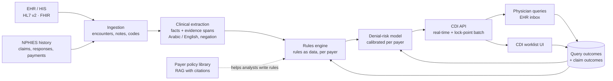

# CDI Engine – Production Implementation Plan (summary)

This plan takes the CDI proof of concept to a production service for emergency-department claims in a Saudi hospital network. It covers what to build, in what order, how to know it works, and what has to be decided first. For what the POC does today, see [README.md](README.md).

---

## 1. Goal

Before each ED claim is submitted to the insurer, find the documentation gaps that will cause a denial and the coding that the documentation could support. Route both to the right person (coder, CDI specialist or physician) while there is still time to fix them.

**What the product is:** a review step between coding and submission (the "lock point"), plus a worklist for the CDI team and compliant physician queries.

**What it is not:** an auto-coder. Every suggestion is confirmed by a person, and a code is changed only when the documentation supports it.

**Success after the pilot** (targets set against the baseline measured in Phase 0):

| KPI | Direction |
|---|---|
| Initial denial rate on reviewed claims | Down, e.g. a 20–30% relative reduction for the denial reasons in scope |
| First-pass acceptance rate (NPHIES) | Up |
| Revenue recovered (denials avoided + specificity captured) | Measured per month, net of review effort |
| Physician query response rate and agreement rate | > 80% response; agreement tracked per rule |
| Rule precision (CDI specialist agrees the finding is real) | ≥ 85% for any rule that is switched on |
| Time to review a flagged claim | Stays inside the submission window |

---

## 2. From POC to production: what changes

| Area | POC today | Production |
|---|---|---|
| Data | Synthetic claims and notes | EHR encounters, notes, orders and codes; NPHIES `Claim` / `ClaimResponse` / `PaymentReconciliation` history |
| Reading the note | Regular expressions (no negation, English only) | A clinical extraction service that outputs structured facts with evidence spans, handles negation, and reads Arabic and English notes |
| Rules | 8 Python functions, payer lists in code | Rules as versioned data, maintained by the revenue-cycle team, with payer-specific variants and an approval flow |
| Code sets | Small US-style CPT / CARC samples | ICD-10-AM, SBS procedure codes, NPHIES rejection codes, payer and CCHI policies; licensed and kept up to date |
| Risk model | Logistic regression, random split, synthetic labels | Trained on real outcomes, out-of-time validation, calibrated per payer, versioned and monitored |
| Output | CSV worklist and JSON reports | A worklist UI, physician queries delivered in the EHR, tracking, and an audit trail |
| Running it | CLI on a laptop | Services in a KSA-hosted environment, with an API for real-time and batch checks |

---

## 3. Target architecture

| Component | Responsibility | Notes |
|---|---|---|
| **Ingestion** | Receive encounter, note, order and code events; load NPHIES history | Event-driven (message queue). Keep the PHI that leaves the EHR to the minimum the rules need. |
| **Clinical extraction** | Turn note text into facts: findings, laterality, durations, therapies tried, lab values, signature; each with negation status and the source sentence | The highest-risk build. Options in §6. The output schema is the contract between extraction and rules, so the extractor can be swapped without changing rules. |
| **Rules engine** | Evaluate facts + codes + payer against active rules; produce findings, suggested codes and query templates | Rules stored as data (a JSON/YAML DSL or a decision table) with version, owner, payer scope, effective dates and test cases. A rule is switched on only after it passes its tests and a precision check in shadow mode. |
| **Denial-risk model** | Score each claim; explain the top drivers | Start with the POC's explainable approach (logistic regression on rule flags + context). Move to gradient boosting only if out-of-time tests show a gain. Model registry, per-payer calibration, monthly retraining. |
| **CDI API** | `POST /review` for one encounter (real time, during the visit) and a batch job at the lock point | Stateless, like `CdiEngine.analyze` today. Rules respond in under 1 second; extraction can be asynchronous. |
| **Worklist and queries** | Rank claims by risk × value; send non-leading queries; track sent, answered, agreed and coded | Query templates keep the POC's compliance rule: clinical indicators plus multiple choice, always with "Other" and "Clinically undetermined". |
| **Feedback store** | Query outcomes, coder decisions, final claim outcomes | Labels for retraining, and per-rule precision for the rules team |
| **Payer policy library** | Search payer policies and circulars with clause-level citations | Reuses the RAG POC. Helps analysts write and update rules; it does not make claim decisions. |

**Platform:** containerised services on a KSA-region cloud or on-premises Kubernetes; PostgreSQL for claims, findings and rules; object storage for notes; a message queue; central logging, metrics and tracing; infrastructure as code; CI/CD with automated tests for every rule and model.

---

## 4. Security, privacy and compliance

These are blockers, not extras.

- **Data residency:** PHI stays in KSA. Any LLM used for extraction runs in-country (self-hosted, or a provider region approved for PHI).
- **PDPL (Saudi Personal Data Protection Law):** a data protection impact assessment, a lawful basis and data-sharing agreements with the hospitals, data minimisation, defined retention periods.
- **NCA Essential Cybersecurity Controls** (and the hospital's own policies): encryption in transit and at rest, single sign-on with role-based access (coder, CDI specialist, physician, admin), least privilege, vulnerability management, penetration test before go-live.
- **Audit trail:** who saw which record, every finding, every suggestion accepted or rejected, every query and answer, and the rule and model versions that produced them.
- **Clinical and coding compliance:** non-leading queries (ACDIS/AHIMA practice), no automatic code changes, a documented review process when a rule is challenged.
- **AI governance:** a model card for the risk model and the extractor, evaluation results per release, drift monitoring, and a human in the loop for every action.

---

## 5. Delivery roadmap

| Phase | Duration (estimate) | Scope | Exit criteria |
|---|---|---|---|
| **0. Discovery and data access** | 4–6 weeks | DPIA and data agreements; access to 12–24 months of ED encounters, notes and NPHIES history; baseline denial analysis (top rejection codes by payer, value and volume); choose 8–12 rules covering the biggest avoidable denial reasons; decide the extraction approach | Data flowing into a secure environment; baseline KPIs agreed; rule backlog prioritised by value |
| **1. MVP in shadow mode** | 8–10 weeks | Ingestion; extraction v1; rules engine with the first rules as data; risk model retrained on real outcomes; read-only worklist. Scores every claim, changes nothing. | Rule precision measured by CDI specialists on ≥ 500 claims; out-of-time AUC and calibration per payer reported; rules below 85% precision fixed or held back |
| **2. Pilot** | 8–12 weeks | One hospital, ED only, a subset of payers. Live worklist and physician queries in the EHR, feedback capture, training for coders and CDI staff, support runbook | KPI movement against the baseline or a control group (e.g. another site); query response > 80%; no compliance findings; users keep using it |
| **3. Scale** | ongoing, quarterly releases | More sites and payers; rules UI for the revenue-cycle team; real-time check during the visit; Arabic note coverage; outcome-driven retraining; feed of open alerts into claim funding | Each new rule and site passes the same shadow-then-pilot gate |

---

## 6. Decisions needed before Phase 1

| Decision | Options | Recommendation |
|---|---|---|
| **Clinical extraction** | (a) Hosted LLM in a KSA-approved region; (b) self-hosted open model, optionally fine-tuned with QLoRA on annotated notes; (c) commercial clinical NLP product | Start with (a) or (b) behind the fact-schema contract. Build an annotated evaluation set (300–500 notes labelled by CDI specialists) first, and choose by measured accuracy, cost and residency. |
| **Rules authoring** | Code changes by engineers vs a DSL / decision table owned by the revenue-cycle team | DSL with versioning and tests from day one. The rules team owns the content; engineering owns the engine. |
| **Where the check runs** | Lock-point batch only vs also in real time during the visit | Batch for the MVP (simpler, still in time to fix); real time in Phase 3 |
| **EHR integration** | Native EHR worklist and inbox vs a separate web app linked from the EHR | A separate app for the pilot, with queries delivered to the EHR inbox; deeper integration once the value is proven |
| **Build vs buy** | Commercial CDI products exist | Compare in Phase 0. The case for building is payer-specific KSA rules, NPHIES data and the link to claim funding. |

---

## 7. Team (pilot phase)

Product owner · 1–2 CDI specialists / senior coders (rule content, labelling, review) · tech lead · 2 backend engineers · 1 integration engineer (HL7/FHIR, NPHIES) · 1 data engineer · 1 ML engineer · 1 frontend engineer · QA · part-time security and compliance officer · a clinical champion in the pilot ED.

---

## 8. Main risks

| Risk | Mitigation |
|---|---|
| Data access and agreements take longer than planned | Start the DPIA and agreements in week 1; develop on de-identified extracts meanwhile |
| Extraction accuracy on real, mixed-language notes is lower than expected | Annotated evaluation set before any build decision; rules switched on only above the precision threshold |
| Alert fatigue: too many low-value findings | Rank by risk × claim value; per-rule precision gate; review volume limits per user |
| Payer rules change without notice | Drift monitoring per payer × service line (as in the funding POC); policy library to update rules quickly |
| Queries seen as leading or as upcoding | Compliant templates, compliance review of every template, audit trail |
| Model learns hospital-specific habits, not payer behaviour | Out-of-time validation, per-site evaluation, shadow mode before every new site |

---

## 9. How the other POCs fit in

- **Claim funding** (`funding-poc/`): open high-severity CDI alerts and documentation completeness are among the strongest predictors of approval. In production the CDI service publishes them per claim, and the funding model consumes them.
- **Policy Q&A** (`rag-poc/`): a searchable library of payer and CCHI policies with clause-level citations, used by the rules team to write and update rules and to answer coder questions. It supports people; it does not decide claims.
