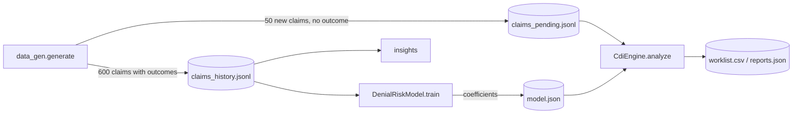
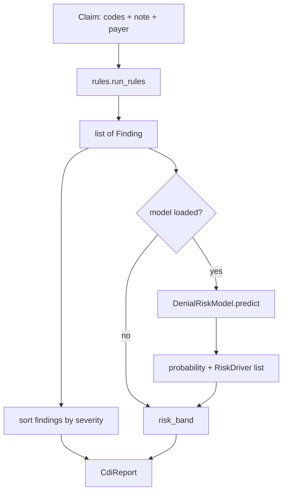

# CDI Engine – Proof of Concept

Pre-submission **Clinical Documentation Improvement** for insurance claims. Insurers reject claims when the clinical documentation doesn't support what was billed, and hospitals lose revenue when codes are less specific than the documentation allows. The engine reviews each claim (codes + clinical note) **before it is submitted** and:

1. **Finds documentation gaps that cause denials**: missing prior auth, diagnosis not supporting the procedure, weak medical necessity, unsupported E/M level, missing laterality or signature.
2. **Finds coding opportunities**: the note supports a more specific or additional diagnosis (diabetes complications, heart-failure type, pneumonia organism, anemia, hyponatremia, obesity).
3. **Drafts compliant physician queries**: states the clinical indicators and offers multiple choices including *Other* and *Clinically undetermined*, so the query never leads towards a code (ACDIS/AHIMA guidance).
4. **Scores denial risk** with a model trained on historical claim outcomes (paid / denied), and explains the top risk drivers.

| Output | Example |
|---|---|
| **Denial risks** | "PAYER_C requires prior authorisation for 73721 but none is on the claim" (→ CO-197) |
| **Coding opportunities** | "Hemoglobin 8.8 g/dL documented with no anemia diagnosis" |
| **Physician queries** | "Can you clarify the diagnosis, if any, associated with these findings?" with multiple-choice options |
| **Denial probability** | 0.95 (HIGH), driven by `rule=PRIOR_AUTH_MISSING` |

The engine **only suggests**. It never changes a code. A coder or CDI specialist confirms every suggestion, and a code is used only when the documentation supports it.

> All data is **synthetic**. No real patient information is used or needed.

---

## Contents

1. [Quick start](#quick-start)
2. [Sample output](#sample-output)
3. [How it works](#how-it-works)
4. [Project layout](#project-layout)
5. [Implementation, module by module](#implementation-module-by-module)
6. [Outputs](#outputs)
7. [Results on the synthetic data](#results-on-the-synthetic-data)
8. [Tests](#tests)
9. [Design decisions](#design-decisions)
10. [Limitations](#limitations)
11. [Path to production](#path-to-production)

---

## Quick start

```bash
uv venv .venv && uv pip install --python .venv/bin/python -r requirements.txt
# or: python -m venv .venv && .venv/bin/pip install -r requirements.txt

.venv/bin/python -m cdi demo          # generate data → train → insights → worklist → sample report
.venv/bin/python -m pytest            # tests
```

Requirements: Python 3.11+ (uses `enum.StrEnum`), scikit-learn, numpy, pandas, pytest. Run commands from the `cdi-poc/` folder; everything is written to `data/`.

| Command | What it does |
|---|---|
| `python -m cdi generate [--n 600 --pending 50 --seed 42]` | Synthetic adjudicated history + new pending claims → `data/*.jsonl` |
| `python -m cdi train` | Train the denial-risk model → `data/model.json`, prints ROC-AUC and average precision |
| `python -m cdi insights` | Denials by code and payer; per rule: denial rate when fired vs not, precision/recall vs injected defects |
| `python -m cdi worklist [--top 10]` | Score pending claims → `data/worklist.csv` (sorted by risk) + `data/reports.json` |
| `python -m cdi analyze --claim-id NEW-00027 [--json]` | Full CDI report for one claim (history or pending) |
| `python -m cdi demo [--n --pending --seed]` | All of the above in order, then prints the pending claim with the most findings |

If `data/model.json` doesn't exist, `worklist` and `analyze` print a notice and run **rules only** (no probability).

## Sample output

From `python -m cdi demo` (seed 42):

```
Claim NEW-00009  PAYER_B  INPATIENT  DOS 2026-02-04
  CPT: 99223 (Initial hospital inpatient care, high MDM), 71046 (Radiologic exam, chest, 2 views)
  DX:  E11.9 (Type 2 diabetes mellitus without complications)
  Denial risk: 0.42 (MEDIUM)
  Risk drivers: rule=DX_PX_MISMATCH (+2.29)

  [HIGH] DX_PX_MISMATCH (DENIAL_RISK) → CO-11
    No diagnosis on the claim supports 71046 (Radiologic exam, chest, 2 views).
    Action: Review the note for the condition that justified the procedure and code it.
    Evidence: "Claim diagnoses: E11.9"

  [MEDIUM] ANEMIA_INDICATORS (CODING_OPPORTUNITY)
    Hemoglobin 8.8 g/dL documented with no anemia diagnosis.
    Evidence: "Hemoglobin 8.8 g/dL."
    Suggested (if confirmed): D64.9 Anemia, unspecified
    Physician query – Low hemoglobin: Can you clarify the diagnosis, if any, associated with these findings?
      Options: Acute blood loss anemia | Anemia of chronic disease | Iron deficiency anemia |
               Not clinically significant | Other (please specify) | Clinically undetermined
```

The pneumonia diagnosis was left off this claim, so nothing supports the chest x-ray (CO-11). The note also shows a culture result (*Streptococcus pneumoniae*), but the pneumonia-organism rule only fires when `J18.9` is on the claim, so it stays silent until the coder fixes the primary diagnosis.

---

## How it works

### End to end (`python -m cdi demo`)



1. **Generate**: synthetic historical claims, each with a simulated insurer outcome, plus new claims waiting for review.
2. **Train**: run the rules on every historical claim, turn the results into features, fit a logistic-regression denial model.
3. **Insights**: which documentation gaps drive denials, and how accurate each rule is.
4. **Worklist**: analyse each new claim and rank them by denial risk for the CDI team.

### Analysing one claim (`CdiEngine.analyze`)



1. **Rules** read the claim's codes and clinical note and produce `Finding`s. Each has evidence (the sentences quoted from the note), a recommended action, the likely denial code, any suggested codes, and an optional `PhysicianQuery`.
2. **The model** turns the findings plus the claim's context (payer, procedure codes, encounter type, billed amount) into a feature vector and returns a denial probability, with the features that pushed the risk up most.
3. **The risk band** combines the probability with how severe the findings are:

   | Condition | Band |
   |---|---|
   | probability ≥ 0.5 | HIGH |
   | probability ≥ 0.2, **or** any HIGH-severity finding | MEDIUM |
   | otherwise | LOW |
   | no model loaded | HIGH if any HIGH finding, else LOW |

4. **The report** (`CdiReport`) bundles all of this for the claim.

Rules and model are layered on purpose: rules give specific, explainable actions; the model learns from real outcomes which of those gaps actually lead to denials for which payer, and ranks claims. Either works without the other.

---

## Project layout

```
cdi-poc/
├── cdi/
│   ├── __main__.py     # entry point: python -m cdi
│   ├── cli.py          # commands: generate, train, analyze, worklist, insights, demo
│   ├── codes.py        # reference data: codes, payer policies, denial codes
│   ├── models.py       # data classes: Claim, Finding, PhysicianQuery, CdiReport, …
│   ├── rules.py        # deterministic CDI rules
│   ├── risk_model.py   # denial-risk model (train / predict / explain / save)
│   ├── engine.py       # CdiEngine: rules + model → CdiReport
│   └── data_gen.py     # synthetic claims and simulated insurer decisions
├── tests/
│   ├── test_rules.py   # each rule, positive and negative cases
│   └── test_engine.py  # generator, model, engine end to end
└── data/               # generated at runtime (not committed)
```

---

## Implementation, module by module

### `models.py`: data classes

The data structures every other module uses.

| Class | Purpose | Key fields |
|---|---|---|
| **`Claim`** | One insurance claim, the engine's input. | `claim_id`, `payer`, `encounter_type`, `date_of_service`, `provider_id`, `patient_age`, `patient_sex`, `dx_codes` (ICD-10), `cpt_codes` (procedures), `billed_amount`, `note` (clinical text), `prior_auth_number`. Historical claims also carry `outcome` (PAID/DENIED) and `denial_code`. `scenario` and `injected_defects` are ground truth from the generator, used **only** to measure rule accuracy and **never** as model features. `from_dict` ignores unknown keys; `to_dict` gives JSON. |
| **`Finding`** | One issue detected by a rule. | `rule_id`, `category`, `severity`, `message`, `recommendation`, `evidence`, `likely_denial_code`, `suggested_codes`, `query` |
| **`PhysicianQuery`** | A compliant question to the clinician: states the clinical indicators and offers choices, always including "Other" and "Clinically undetermined". | `topic`, `clinical_indicators`, `question`, `options` |
| **`RiskDriver`** | One feature that raised a claim's denial probability. | `feature` (e.g. `rule=PRIOR_AUTH_MISSING`), `contribution` (effect on the log-odds) |
| **`CdiReport`** | The engine's output for one claim. | `claim_id`, `denial_probability`, `risk_band`, `findings`, `risk_drivers`; `to_dict` gives JSON |
| **`Category`** (StrEnum) | Type of finding. | `DENIAL_RISK` (likely rejection), `CODING_OPPORTUNITY` (more specific or additional code supported), `COMPLIANCE` (documentation integrity, e.g. missing signature) |
| **`Severity`** (StrEnum) | Urgency. | `HIGH`, `MEDIUM`, `LOW` |

### `codes.py`: reference data

Static lookup tables. A production system would load these from maintained sources (NPHIES/CCHI rules in KSA, CMS NCCI edits in the US).

| Name | Purpose |
|---|---|
| `ICD10`, `CPT` | Small illustrative subsets of diagnosis and procedure codes, with descriptions |
| `SUPPORTING_DX_PREFIXES` | For each procedure, the diagnosis prefixes that justify it (knee MRI 73721 needs M17/M23/M25.56/S83; echo 93306 needs I50/I10/R06/R07; chest x-ray 71046 needs J13/J15/J18/R05/R06). Procedures not listed (E/M visits) accept any diagnosis. |
| `PRIOR_AUTH_REQUIRED` | Per payer, the procedures that need prior authorisation (PAYER_A: MRI + arthroscopy; PAYER_B: arthroscopy; PAYER_C: MRI + arthroscopy + echo) |
| `PAYERS` | The three synthetic payers |
| `UNSPECIFIED_CODES` | "Unspecified" codes that usually have a more specific alternative |
| `LATERALITY_CODE_PREFIXES` | Code families that need the side (M17, S83) |
| `DENIAL_CODES` | CARC-style claim adjustment reason codes: CO-11, CO-16, CO-50, CO-150, CO-197, CO-29 |
| `describe(code)` | Readable description of any code (falls back to the code itself) |

### `rules.py`: CDI rules

Each rule is a plain function `rule(claim) -> list[Finding]`. Rules are deterministic and explainable, and they are the backbone of the engine. They work on regular expressions over the note, split into sentences so evidence can be quoted.

| Rule function | Rule ID(s) emitted | What it checks | Category / severity | Likely denial |
|---|---|---|---|---|
| `signature_missing` | `SIGNATURE_MISSING` | No "electronically signed by" / "signed by Dr" in the note | COMPLIANCE / HIGH | CO-16 |
| `prior_auth_missing` | `PRIOR_AUTH_MISSING` | The payer requires prior auth for a billed procedure, but `prior_auth_number` is empty | DENIAL_RISK / HIGH | CO-197 |
| `dx_px_mismatch` | `DX_PX_MISMATCH` | No diagnosis on the claim matches the procedure's `SUPPORTING_DX_PREFIXES` (one finding per unsupported procedure) | DENIAL_RISK / HIGH | CO-11 |
| `medical_necessity` | `MEDICAL_NECESSITY_MRI` | Knee MRI without conservative therapy (PT, NSAIDs, home exercise, injection) **and** ≥ 6 weeks of symptoms; the message lists what is missing | DENIAL_RISK / HIGH | CO-50 |
| | `MEDICAL_NECESSITY_ARTHROSCOPY` | Arthroscopy without mechanical symptoms (locking, catching, giving way) or an MRI-confirmed tear | DENIAL_RISK / HIGH | CO-50 |
| `laterality` | `LATERALITY_NOT_CODED` | Unspecified knee code (M17.9, S83.209A), but the note states the side: suggests the specific code | CODING_OPPORTUNITY / MEDIUM | CO-16 |
| | `LATERALITY_NOT_DOCUMENTED` | Unspecified knee code and no side in the note: raises a query (Right / Left / Bilateral / …) | DENIAL_RISK / MEDIUM | CO-16 |
| `diagnosis_specificity` | `DIABETES_SPECIFICITY` | E11.9 with neuropathy keywords (→ E11.40), glucose ≥ 250 or "hyperglycemia" (→ E11.65), eGFR < 60 or CKD (→ E11.22) | CODING_OPPORTUNITY / MEDIUM | – |
| | `HEART_FAILURE_SPECIFICITY` | I50.9 coded. EF ≤ 40% suggests systolic (I50.22/I50.23); EF ≥ 50% or "preserved/diastolic" suggests I50.32. Severity is HIGH when the EF points to a code, otherwise MEDIUM | CODING_OPPORTUNITY | – |
| | `PNEUMONIA_ORGANISM` | J18.9 coded, but the culture "grew" / was "positive for" *S. pneumoniae* (→ J13) or *Pseudomonas* (→ J15.1) | CODING_OPPORTUNITY / MEDIUM | – |
| `clinical_indicators_without_dx` | `ANEMIA_INDICATORS` | Hemoglobin < 10 g/dL with no D5x/D6x code | CODING_OPPORTUNITY / MEDIUM | – |
| | `HYPONATREMIA_INDICATORS` | Sodium < 135 mmol/L without E87.1 | CODING_OPPORTUNITY / LOW | – |
| | `OBESITY_INDICATORS` | BMI ≥ 40 with no E66 code | CODING_OPPORTUNITY / LOW | – |
| `em_level_support` | `EM_LEVEL_NOT_SUPPORTED` | 99215 billed without "MDM: high" / high-complexity decision-making, or ≥ 40 minutes total time | DENIAL_RISK / MEDIUM | CO-150 |

All coding opportunities except laterality come with a non-leading `PhysicianQuery`.

Supporting pieces:

| Name | Purpose |
|---|---|
| `Rule` | Type alias `Callable[[Claim], list[Finding]]` |
| `ALL_RULES` | The ordered list of rules the engine runs |
| `run_rules(claim, rules)` | Runs every rule and flattens the findings |
| `_sentences`, `_evidence` | Split the note into sentences; quote the ones matching a pattern |
| `_has`, `_number` | Case-insensitive pattern test; read the first numeric capture (lab value, weeks, minutes, EF) |
| `_has_dx`, `_laterality` | Diagnosis-prefix check on the claim; detect right / left / bilateral in the note |
| `UNDETERMINED_OPTIONS` | "Other (please specify)" and "Clinically undetermined", appended to every query |

**Adding a rule:** write a function that returns `Finding`s, add it to `ALL_RULES`, and add positive and negative tests in `tests/test_rules.py`. The model picks the new rule up as a feature the next time you run `train`. If the synthetic generator should inject the defect too, add it to a scenario in `data_gen.py` and to `DENIAL_BEHAVIOUR`.

### `risk_model.py`: denial-risk model

Logistic regression on top of the rule output, chosen so every score can be explained feature by feature.

**Features** (`features(claim, findings)`), as a sparse dict vectorised with scikit-learn's `DictVectorizer`:

| Feature | Value |
|---|---|
| `rule=<RULE_ID>` | 1 for each finding, **except** pure coding opportunities with no likely denial code (they affect revenue, not denials; including them produced misleading "risk drivers"). `LATERALITY_NOT_CODED` stays in because it carries CO-16. |
| `payer=<PAYER>` | 1 |
| `encounter=<TYPE>` | 1 (OUTPATIENT, DAY_SURGERY, INPATIENT) |
| `cpt=<CODE>` | 1 per billed procedure |
| `log_billed_amount` | `log1p(billed_amount)` |

**Training** (`DenialRiskModel.train(claims, seed=7)`):

1. Keep claims with an outcome; run the rules on each; build feature dicts; label = `outcome == "DENIED"`.
2. Hold out 25%, stratified by outcome (`train_test_split`).
3. Fit `LogisticRegression(C=1.0, max_iter=2000)`.
4. Record `TrainingMetrics`: `n_train`, `n_test`, `denial_rate`, `roc_auc`, `average_precision` on the held-out set.
5. Store feature names, coefficients, intercept and the **training means** of each feature.

**Prediction and explanation** (`predict(claim, findings, top_k=3)`):

```
probability          = sigmoid(coef · x + intercept)
contribution_i       = coef_i × (x_i − training_mean_i)
risk drivers         = features present on this claim with contribution > 0, top 3
```

Features unseen in training are ignored. Measuring contributions against the training mean means a driver reads as "this pushed the claim above an average claim", rather than as a raw coefficient.

**Persistence**: `save(path)` / `load(path)` write **plain JSON** (feature names, coefficients, intercept, means, metrics). No pickle: safer to load, human-readable, easy to diff and version.

### `engine.py`: orchestration

| Name | Purpose |
|---|---|
| **`CdiEngine(model=None, rules=ALL_RULES)`** | The main entry point. Without a model it runs rules only. |
| `CdiEngine.analyze(claim)` | Runs the rules, scores with the model, sorts findings HIGH → LOW, assigns the band, returns a `CdiReport` (probability rounded to 3 decimals). It keeps no state between claims, so it can sit behind an API for real-time checks during the visit. |
| `risk_band(prob, has_high_finding)` | The banding logic above |
| `HIGH_RISK`, `MEDIUM_RISK` | Thresholds 0.5 and 0.2 |

Usage from Python:

```python
from pathlib import Path
from cdi.engine import CdiEngine
from cdi.risk_model import DenialRiskModel
from cdi.models import Claim

engine = CdiEngine(DenialRiskModel.load(Path("data/model.json")))
report = engine.analyze(Claim(
    claim_id="X-1", payer="PAYER_A", encounter_type="OUTPATIENT", date_of_service="2026-03-01",
    provider_id="PRV-001", patient_age=54, patient_sex="F",
    dx_codes=["M17.9"], cpt_codes=["73721"], billed_amount=1200.0,
    note="Knee pain for 3 weeks. Started NSAIDs. Electronically signed by Dr. L. Chen, MD.",
))
print(report.denial_probability, report.risk_band, [f.rule_id for f in report.findings])
```

### `data_gen.py`: synthetic data and simulated insurer

The generator writes realistic notes and codes, **injects documentation defects** at known rates, and then lets a simulated insurer decide each claim. Because every claim records which defects were injected, rule precision and recall can be measured honestly.

**Scenarios** (`SCENARIOS`: builder, encounter type, share of claims):

| Scenario | Encounter | Share | Codes | Defects it can inject |
|---|---|---|---|---|
| `_diabetes_followup` | OUTPATIENT | 30% | 99214 / 99215, E11.x | `DIABETES_SPECIFICITY`, `OBESITY_INDICATORS`, `EM_LEVEL_NOT_SUPPORTED` |
| `_knee_mri` | OUTPATIENT | 20% | 73721, M17.x | `MEDICAL_NECESSITY_MRI`, `LATERALITY_NOT_DOCUMENTED`, `LATERALITY_NOT_CODED`, `DX_PX_MISMATCH` |
| `_knee_arthroscopy` | DAY_SURGERY | 15% | 29881, S83.x | `MEDICAL_NECESSITY_ARTHROSCOPY`, `LATERALITY_NOT_CODED` |
| `_pneumonia_admission` | INPATIENT | 20% | 99223 + 71046, J18.9 / J13 / J15.1 | `PNEUMONIA_ORGANISM`, `ANEMIA_INDICATORS`, `HYPONATREMIA_INDICATORS`, `DX_PX_MISMATCH` |
| `_heart_failure` | OUTPATIENT | 15% | 99214 + 93306, I50.x | `HEART_FAILURE_SPECIFICITY`, `DX_PX_MISMATCH` |

Every claim can also get `SIGNATURE_MISSING` (8%) and, if the payer requires it for a billed procedure, `PRIOR_AUTH_MISSING` (20%).

**Simulated insurer** (`adjudicate(defects, payer, rng)`):

- `DENIAL_BEHAVIOUR` gives each defect a denial probability and code: prior auth 0.90 (CO-197), dx/px mismatch 0.85 (CO-11), medical necessity 0.70 (CO-50), signature 0.60 (CO-16), E/M level 0.45 (CO-150), laterality 0.25–0.40 (CO-16), specificity 0.05–0.10 (CO-16). Coding opportunities (anemia, sodium, BMI) have probability 0: they cost revenue but don't cause rejections.
- `PAYER_STRICTNESS` multiplies each probability (PAYER_A 1.0, PAYER_B 0.8 lenient, PAYER_C 1.15 strict), capped at 0.97.
- Defects are checked highest-impact first; the first one that triggers sets the denial code.
- `BASE_DENIAL`: 4% random CO-29 (late filing) denials unrelated to documentation, as realistic noise no rule can catch.

| Name | Purpose |
|---|---|
| `generate_claim(i, rng)` | Picks a scenario and payer, builds the note, adds signature / prior-auth defects, adjudicates, and returns a `Claim` (dates of service across Jan–Aug 2026) |
| `generate(n, seed)` | `n` claims; the same seed always gives the same data |
| `save(claims, path)` / `load(path)` | JSON Lines |

Two **realistic traps** are included on purpose, to show where keyword rules break:
- **Negation:** *"Monofilament exam normal, no neuropathy."* The diabetes rule matches "neuropathy" and misfires, lowering its precision.
- **Mentioned but not done:** *"Physical therapy recommended but not yet started."* The MRI rule sees "physical therapy" and misses the gap, lowering its recall.

### `cli.py`: commands

| Function | Command | Output |
|---|---|---|
| `cmd_generate` | `generate [--n --pending --seed]` | `data/claims_history.jsonl`; `data/claims_pending.jsonl` (generated with `seed + 1`, IDs renamed `NEW-…`, outcome removed) |
| `cmd_train` | `train` | `data/model.json`; prints ROC-AUC and average precision |
| `cmd_insights` | `insights` | Denials by code and payer; per rule: times fired, denial rate when fired vs not, precision/recall against injected defects |
| `cmd_worklist` | `worklist [--top]` | `data/worklist.csv` (ranked by risk), `data/reports.json` (full reports); prints band counts, number of queries, top claims |
| `cmd_analyze` | `analyze --claim-id X [--json]` | One claim's full report as readable text or JSON |
| `cmd_demo` | `demo` | Runs everything above, then prints the pending claim with the most findings |
| `print_report` | – | Readable report: codes, note, risk, drivers, findings, evidence, suggested codes, queries |
| `_engine`, `_load_all`, `_rate`, `main` | – | Load the model (or fall back to rules only), load history + pending, format rates, parse arguments |

---

## Outputs

**`data/worklist.csv`**: one row per pending claim, highest risk first.

| Column | Meaning |
|---|---|
| `claim_id`, `payer`, `cpt_codes`, `dx_codes` | Claim identity and codes |
| `denial_probability`, `risk_band` | Model score and band |
| `denial_risks` | Number of denial-risk and compliance findings |
| `coding_opportunities` | Number of coding-opportunity findings |
| `physician_queries` | Number of queries to send |
| `top_issue` | The most severe finding's message |
| `suggested_codes` | All codes suggested for the claim (each needs confirmation) |

**`data/reports.json`**: the full `CdiReport` for every pending claim, including evidence and query text.

**`data/model.json`**: feature names, coefficients, intercept, training means and metrics.

---

## Results on the synthetic data

From `python -m cdi demo` with the defaults (600 history claims, 50 pending, seed 42):

- **Denial rate** 26.3% (158/600). Top reasons: CO-197 prior auth (44), CO-50 medical necessity (31), CO-16 missing information (31), CO-29 late filing noise (25).
- **By payer**: PAYER_B 20.4% (lenient), PAYER_A 28.0%, PAYER_C 29.7% (strict).
- **Model**: trained on 450, tested on 150; **ROC-AUC 0.870, average precision 0.790**.
- **Worklist**: 5 HIGH, 8 MEDIUM, 37 LOW; 27 physician queries to send.

Rule impact (excerpt from `insights`):

| Rule | Fired | Denied when fired | Denied otherwise | Precision | Recall |
|---|---|---|---|---|---|
| PRIOR_AUTH_MISSING | 47 | 96% | 20% | 100% | 100% |
| DX_PX_MISMATCH | 25 | 88% | 24% | 100% | 100% |
| MEDICAL_NECESSITY_ARTHROSCOPY | 15 | 87% | 25% | 100% | 100% |
| MEDICAL_NECESSITY_MRI | 33 | 76% | 23% | 100% | **75%** (therapy-not-started trap) |
| SIGNATURE_MISSING | 49 | 65% | 23% | 100% | 100% |
| DIABETES_SPECIFICITY | 51 | 14% | 28% | **73%** (negation trap) | 100% |
| ANEMIA_INDICATORS | 24 | 12% | 27% | 100% | 100% |

Coding-opportunity rules show *lower* denial rates when they fire: they mark revenue left on the table, not rejection risk, which is why the model ignores them.

---

## Tests

`python -m pytest` runs 16 tests in about a second.

| File | What it covers |
|---|---|
| `tests/test_rules.py` | A clean claim has no findings; each rule fires on a defective claim and stays silent on a correct one: signature, payer-specific prior auth, dx/px mismatch, MRI necessity (short duration and untreated), laterality coded vs documented (suggested code / query with "Clinically undetermined"), diabetes specificity from lab values and not from normal labs, heart failure EF, anemia/sodium/BMI with and without the diagnosis coded, E/M level by time and by MDM |
| `tests/test_engine.py` | Generator determinism; the model reaches ROC-AUC > 0.75 and survives a JSON save/load with identical scores; claims with a HIGH finding score more than twice clean claims; the engine works without a model |

---

## Design decisions

| Decision | Why |
|---|---|
| Rules first, model on top | Rules give specific, explainable actions; the model ranks claims by learning from outcomes. Either works alone. |
| Logistic regression | Every score can be explained feature by feature. A more complex model can replace it once real data exists. |
| Coding opportunities left out of model features | They don't cause denials; leaving them in produced misleading "risk drivers". |
| Contributions relative to the training mean | Drivers read as "above a typical claim", not as raw coefficients. |
| Non-leading physician queries | Required by CDI compliance guidance (ACDIS/AHIMA); protects against upcoding accusations. |
| Ground truth stored but never used as a feature | Honest measurement of rules without leaking answers into the model. |
| JSON model storage | No pickle to load; human-readable; easy to version. |
| Stateless engine | Can sit behind an API and re-check a note while the visit is still under way. |

## Limitations

- **The model learns the generator.** ROC-AUC ≈ 0.87 here proves the pipeline, not real-world accuracy. Real accuracy needs remittance / claim-response history (835 files in the US, NPHIES `ClaimResponse` in KSA).
- **Random train/test split.** Fine for synthetic data with no time trend; with real data, split by date so payer policy changes show up in the test.
- **Keyword rules have no negation or synonym handling**, visible in `insights` (diabetes precision 73%, MRI recall 75%).
- **Tiny, illustrative code set and payer policies**, in Python dicts. US-style CPT and CARC codes are used for readability.
- **Suggestions only.** The engine never changes codes.

## Path to production

1. **Real data**: historical claims + remittance/denial responses; retrain and re-measure per payer, with out-of-time evaluation.
2. **Clinical NLP / LLM extraction**: replace regexes with an extraction step (negation, abbreviations, Arabic/English notes) that outputs structured facts the same rules consume. Run it on an in-country, PHI-approved deployment.
3. **Local standards**: for KSA, NPHIES FHIR claims and responses, CCHI policies, SBS procedure codes, ICD-10-AM, NPHIES rejection codes.
4. **Rules as data**: payer policies in a versioned table maintained by the revenue-cycle team, not in code.
5. **Emergency department scenarios**: chest pain, abdominal pain, trauma, sepsis; ED visit levels; imaging-necessity rules.
6. **Workflow**: CDI worklist UI, query tracking (sent / answered / agreed), audit trail, and feedback of query outcomes into the model.
7. **Metrics**: denial rate and first-pass acceptance before vs after, query response and agreement rates, revenue recovered.
8. **Financing link**: open high-severity CDI alerts and documentation completeness are inputs to the [funding POC](../funding-poc/), which prices claims before submission.
