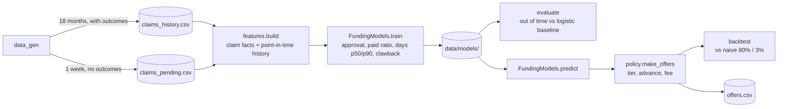

# Claim Funding – LightGBM Proof of Concept

Predict, **at the lock point** (an emergency-department claim has been coded and scrubbed and is about to be submitted to the insurer), how much cash the claim will bring in and when, then turn that into a **tiered funding offer**: how much to advance the hospital today, and at what fee.

| Model | LightGBM objective | Predicts |
|---|---|---|
| Approval | `binary` + Platt calibration | P(insurer approves the claim) |
| Paid ratio | `cross_entropy` | Share of the billed amount paid if approved (insurers cut line items) |
| Days to cash | `quantile` (α = 0.5 and 0.9) | Typical and slow-case days from lock to payment |
| Clawback | per-payer historical rate (no model) | Share of paid money recouped later after audit |

```
expected collectible = billed × P(approve) × paid ratio × (1 − clawback rate)
advance              = tier rate × billed × paid ratio          (A: 80%, B: 50%, C: wait for approval)
fee rate             = cost of capital × p90 days / 365 + (1 − P(approve)) × loss given denial + clawback + ops margin
```

> All data is **synthetic**. No real patient or claim data is used.

---

## Contents

1. [Quick start](#quick-start)
2. [How it works](#how-it-works)
3. [Project layout](#project-layout)
4. [Implementation, module by module](#implementation-module-by-module)
5. [How LightGBM is used, and why](#how-lightgbm-is-used-and-why)
6. [Avoiding leakage](#avoiding-leakage-the-main-way-funding-models-lose-money)
7. [Outputs](#outputs)
8. [Results on the synthetic data](#results-on-the-synthetic-data)
9. [Tests](#tests)
10. [Limitations and next steps](#limitations-and-next-steps)

---

## Quick start

```bash
uv venv .venv && uv pip install --python .venv/bin/python -r requirements.txt
# macOS: LightGBM needs OpenMP. Either `brew install libomp`, or reuse the copy scikit-learn bundles:
scripts/fix_libomp_macos.sh

.venv/bin/python -m funding demo     # generate → train → evaluate → backtest → offers → explain
.venv/bin/python -m pytest           # tests
```

Requirements: Python 3.11+, LightGBM ≥ 4.7, scikit-learn, numpy, pandas, pytest. Run commands from the `funding-poc/` folder; everything is written to `data/`.

| Command | What it does |
|---|---|
| `python -m funding generate [--per-day 40 --seed 42]` | 18 months of ED claims with outcomes (`data/claims_history.csv`) + one week of pending claims (`data/claims_pending.csv`) |
| `python -m funding train [--as-of 2026-08-01]` | Trains the models on claims mature before `as_of` → `data/models/` |
| `python -m funding evaluate` | Out-of-time test vs logistic regression; calibration; per-payer and payer × service-line drift; paid-ratio and timing error; feature importance |
| `python -m funding backtest` | Realised P&L of the policy on test claims vs a naive flat 80% advance |
| `python -m funding offers [--top 10]` | Scores pending claims → `data/offers.csv`, prints the riskiest |
| `python -m funding explain --claim-id NEW-000212` | One pending claim's offer and its approval drivers |
| `python -m funding demo [--per-day --seed --as-of --top]` | All of the above, then explains the lowest-probability pending claim |

### macOS and OpenMP

LightGBM's macOS wheel links against Homebrew's `libomp`. If `import lightgbm` fails with a missing `libomp.dylib`, run `brew install libomp`, or `scripts/fix_libomp_macos.sh [venv]`, which adds an rpath from LightGBM's library to the `libomp` that scikit-learn's wheel already bundles and re-signs the library ad hoc. It only touches files inside the virtualenv; re-run it after reinstalling LightGBM.

---

## How it works



1. **Generate** synthetic ED claims from 2025-04-01 to 2026-09-30, each with the insurer's simulated outcome (approve/deny, amount cut, payment date, possible clawback), and one week of pending claims (2026-10-01 to 10-07) without outcomes.
2. **Build features**: what is known about the claim at the lock point, plus payer and hospital history computed only from events known before the lock date.
3. **Train** on claims old enough for each label to be known on the training date (`as_of`, default 2026-08-01). Validation is the latest 60 days of mature claims.
4. **Evaluate** on claims locked after `as_of` (Aug–Sep 2026), which the models never saw.
5. **Price**: the policy turns predictions into tier, advance and fee. **Backtest** the policy on the test months using the outcomes that actually happened.
6. **Offer** on pending claims, and **explain** any single offer with SHAP values.

The models predict; the policy decides. Thresholds, advance rates and pricing can change without retraining, and each offer records the policy version that made it.

---

## Project layout

```
funding-poc/
├── funding/
│   ├── __main__.py     # entry point: python -m funding
│   ├── cli.py          # commands: generate, train, evaluate, backtest, offers, explain, demo
│   ├── data_gen.py     # synthetic claims + insurer behaviour (approval, cuts, timing, clawbacks, one policy change)
│   ├── features.py     # feature frame: claim facts at lock + point-in-time payer/hospital history
│   ├── models.py       # the LightGBM models, time splits, calibration, explanations, save/load
│   ├── evaluate.py     # out-of-time evaluation, logistic-regression baseline, calibration and drift tables
│   └── policy.py       # tiers, advance, fee; backtest; naive comparison policy
├── scripts/
│   └── fix_libomp_macos.sh
├── tests/
│   └── test_funding.py
└── data/               # generated at runtime (not committed)
```

---

## Implementation, module by module

### `data_gen.py`: synthetic claims and insurer behaviour

Claims arrive as a Poisson number per day (`per_day`, default 40), giving about 21,800 history claims. Each claim is drawn as follows.

**Hospitals** (`HOSPITALS`, `HOSPITAL_SHARE`, `HOSPITAL_PAY_DELAY`):

| Hospital | Share | CDI alerts resolved before lock | Payment delay multiplier |
|---|---|---|---|
| H1 | 45% | 90% | 1.00 |
| H2 | 35% | 75% | 1.05 |
| H3 | 20% | 60% | 1.20 |

**Payers** (`PAYERS`):

| Payer | Share | Base approval log-odds | Low-acuity CT penalty | High-cost review above (SAR) | Mean cut | Typical days to pay | Clawback |
|---|---|---|---|---|---|---|---|
| PAYER_A | 30% | 3.0 | 0.5 | 4,000 | 4% | 35 | 1.0% |
| PAYER_B | 25% | 2.6 | 1.6 | 3,000 | 8% | 55 | 2.0% |
| PAYER_C | 20% | 2.8 | 0.6 | 5,000 | 5% | 45 | 1.5% |
| PAYER_D | 15% | 2.2 | 1.0 | 2,500 | 12% | 80 | 3.0% |
| PAYER_E | 10% | 3.2 | 0.2 | 6,000 | 3% | 30 | 0.5% |

**Clinical and billing facts at the lock point:**

- **Acuity**: CTAS 1 (resuscitation) to 5 (non-urgent), weights 3/15/40/30/12%.
- **Service line**: `LABS_ONLY`, `XRAY`, `CT`, `MINOR_PROCEDURE`, `OBSERVATION`, drawn from `SERVICE_MIX` by acuity (urgent patients get more CT and observation; non-urgent mostly labs).
- **Billed amount**: service median (450 / 700 / 2,200 / 1,500 / 3,800 SAR) × lognormal noise × a small acuity uplift.
- **Prior auth**: required only for CT, minor procedures and observation at CTAS 4–5 (emergencies are exempt); obtained 70% of the time when required.
- **Eligibility** verified on 93% of claims.
- **CDI alerts**: raised during the visit (more at weaker hospitals and for CT / observation); the hospital resolves its quality share; the rest stay open at the lock point, ~40% of them high severity.
- **Documentation completeness**: Beta(9, 2) minus 0.06 per open alert, clipped to [0, 1].

**Insurer decision**: approval is drawn from a logistic function of

```
z = payer base
    − 3.0 × (prior auth required and missing)
    − 2.0 × (eligibility not verified)
    − 1.1 × open high-severity alerts − 0.35 × open low-severity alerts
    + 4.0 × (doc completeness − 0.8)
    − payer CT penalty × (CT at CTAS 4–5)
    − 0.8 × (billed above the payer's high-cost threshold)
    − 1.5 × (PAYER_C CT claim locked on or after 2026-07-01)      ← the policy change
```

The last term is `POLICY_CHANGE`: PAYER_C tightens CT approvals from July 2026, after the training data's validation window, so out-of-time evaluation has real drift to find.

**After approval:**

- **Submission** 0–2 days after lock; **adjudication** 7 + Poisson(0.3 × payer days) after submission.
- **Cut**: Beta-distributed share of billed with a mean of the payer's reduction, +10% if high cost, +3% per open low-severity alert, +5% for low-acuity observation (capped at 60%). `approved_amount = billed × (1 − cut)`, or 0 if denied.
- **Payment**: payer days × hospital delay × lognormal noise, +20 days if high cost, never earlier than 3 days after adjudication. `days_to_cash` is lock to payment.
- **Clawback**: payer rate × (1 + 1.5 × open high alerts), recouping 30–100% of the approved amount 60–240 days after payment.

| Name | Purpose |
|---|---|
| `generate(start, end, per_day, seed, id_prefix)` | Core generator; deterministic for a seed; sorted by lock date with IDs `ED-000001…` |
| `generate_history(per_day, seed)` | 2025-04-01 to 2026-09-30 |
| `generate_pending(per_day, seed)` | 2026-10-01 to 10-07, IDs `NEW-…`, all `OUTCOME_COLUMNS` dropped |
| `save` / `load` | CSV; `load` parses `DATE_COLUMNS` back to timestamps |

### `features.py`: what the models see

Two rules keep the features honest: only facts known at the lock point, and history features that use only events known before the lock date.

**Claim features** (`CLAIM_FEATURES`): `hospital`, `payer`, `service_line` (pandas categoricals with fixed category lists, `CATEGORIES`), `acuity`, `patient_age`, `n_dx`, `billed_amount`, `prior_auth_required`, `has_prior_auth`, `eligibility_verified` (booleans as 0/1), `cdi_alerts_raised`, `open_high_alerts`, `open_low_alerts`, `doc_completeness`.

**History features** (`HISTORY_FEATURES`), computed per claim as of its lock day *t*:

| Feature | Events | Window |
|---|---|---|
| `payer_approval_rate_90d` | approvals for the payer, by **adjudication date** | [t − 90, t) |
| `payer_service_approval_rate_90d` | same, for payer × service line | [t − 90, t) |
| `hospital_approval_rate_90d` | approvals for the hospital, by adjudication date | [t − 90, t) |
| `payer_mean_days_to_cash_180d` | days to cash for the payer, by **paid date** | [t − 180, t) |

Each is NaN when the window holds fewer than `MIN_EVENTS = 30` events (the first months of history, thin payer × service segments).

**`_window_mean`** computes these efficiently: for each key it sorts the events by day, takes a cumulative sum, and uses `searchsorted` to find each query's window bounds, so the mean over [t − window, t) is `(csum[hi] − csum[lo]) / n`. `side="left"` makes the window strictly before *t*: an event on the lock day itself is excluded.

**`APPROVAL_MONOTONE`** and `monotone_vector()` define the approval model's monotone constraints (+1 never lowers approval, −1 never raises it): `eligibility_verified` +1, `doc_completeness` +1, `open_high_alerts` −1, `open_low_alerts` −1, and the three approval-rate history features +1.

`build(claims, history)` returns the feature frame in `FEATURES` order. Pass the claims to score and the history to compute their past from; for training both are the same frame.

### `models.py`: the models

**Label maturity and time splits:**

| Constant | Value | Meaning |
|---|---|---|
| `APPROVAL_MATURITY` | 75 days | Adjudication arrives within about two months of lock |
| `PAYMENT_MATURITY` | 180 days | About 99% of approved claims are paid within ~150 days |
| `CLAWBACK_MATURITY` | 365 days | Recoupments land 2–8 months after payment |
| `VALIDATION` | 60 days | Latest mature window: early stopping and calibration |

- `approval_mask(history, as_of)`: locked before `as_of − 75d` **and** adjudicated before `as_of`.
- `payment_mask(history, as_of)`: locked before `as_of − 180d` **and** paid before `as_of`.
- `time_split(lock, mask)`: of the mature claims, the last 60 days validate and everything earlier trains.

**`FundingModels.train(history, as_of)`**:

1. **Approval**: `LGBMClassifier` with `PARAMS` and the monotone constraints, early-stopped on the validation window.
2. **Calibration**: Platt scaling. A one-feature logistic regression on the validation window's raw log-odds gives `(slope, intercept)`; `p = sigmoid(slope × logit + intercept)`. Strictly monotone, so the ranking (AUC) is unchanged.
3. **Paid ratio**: `LGBMRegressor(objective="cross_entropy")` on approved claims only, label `approved_amount / billed` clipped to [0, 1]; same train/validation split as approval.
4. **Days to cash**: two `LGBMRegressor(objective="quantile")` models, α = 0.5 and α = 0.9, on the payment-mature split.
5. **Clawback rate per payer**: on claims locked more than a year before `as_of` and approved, recouped amount (counted only if recouped before `as_of`) ÷ approved amount.
6. **`TrainingInfo`**: `as_of`, row counts, validation AUC, and the number of trees early stopping kept for each booster.

**`PARAMS`**: `n_estimators=3000` (upper bound), `learning_rate=0.03`, `num_leaves=15`, `min_child_samples=40`, `subsample=0.8` every iteration, `colsample_bytree=0.8`, `reg_lambda=1.0`, `random_state=7`, `n_jobs=1`. `EARLY_STOPPING = 100` rounds.

**`predict(X)`** returns one row per claim: `p_approve_raw`, `p_approve` (calibrated), `paid_ratio`, `days_p50`, `days_p90` (clipped to at least `days_p50`, because two independent quantile models can cross), and `clawback_rate` (by payer, falling back to the mean across payers).

**`explain(X_row, top_k=5)`**: per-feature SHAP contributions to the approval log-odds from `booster.predict(..., pred_contrib=True)`, sorted by absolute size and labelled `feature=value`. They explain the raw score; calibration is monotone, so the order of drivers carries over.

**`importance(top_k=10)`**: each feature's share of the approval model's total split gain.

**`save(dir)` / `load(dir)`**: `approval.txt`, `paid_ratio.txt`, `days_p50.txt`, `days_p90.txt` (LightGBM text format via `model_to_string()`, trimmed to the best iteration) plus `meta.json` (calibration, clawback rates, training info). No pickle.

### `evaluate.py`: out-of-time evaluation

`evaluate(models, history, as_of)` scores every claim locked on or after `as_of` and returns an `Evaluation`:

| Field | Contents |
|---|---|
| `approval` | ROC-AUC, Brier score and log loss for the logistic baseline, raw LightGBM and calibrated LightGBM |
| `calibration` | Predicted vs actual approval in bands `[0, 0.7, 0.85, 0.9, 0.95, 0.98, 1]`, whose edges line up with the funding tiers |
| `by_payer` | n, predicted, actual and gap per payer |
| `drift` | The five payer × service-line segments (n ≥ 30) with the largest positive gap: the payer is stricter than the model knows. A rule change usually hits one service line, and payer averages hide it. |
| `paid_ratio_mae` | Mean absolute error of the paid-ratio model on approved test claims, vs "use the payer's historical average" |
| `days` | Median absolute error of the p50 model, and coverage: share of paid claims paid by the p50 (target 50%) and p90 (target 90%) estimates |
| `importance` | Approval split-gain shares |

`logistic_baseline()` is the honest comparison: same features, same training rows, with one-hot encoding for the categoricals and `SimpleImputer(add_indicator=True)` + `StandardScaler` for the numeric columns, as a linear model needs.

### `policy.py`: offers and backtest

**`Policy`** (frozen dataclass, `version = "2026-10-v1"`):

| Field | Default | Meaning |
|---|---|---|
| `tier_a_min_p` | 0.95 | Tier A: fund before submission at `advance_a` |
| `tier_b_min_p` | 0.85 | Tier B: fund before submission at `advance_b`, the rest after approval |
| `advance_a` / `advance_b` | 0.80 / 0.50 | Share of the expected approved amount (billed × predicted paid ratio) |
| `max_open_high_alerts` | 0 | Any unresolved high-severity CDI alert drops the claim to tier C |
| `cost_of_capital` | 0.12 | Annual |
| `ops_margin` | 0.01 | Of the advance |
| `loss_given_denial` | 0.30 | Share of a shortfall not recovered through recourse or substitution |

**`make_offers(claims, pred, policy)`** returns one row per claim:

1. `expected_approved = billed × paid_ratio`; `expected_collectible = expected_approved × p_approve × (1 − clawback_rate)`.
2. **Tier**: A if no open high alerts and p ≥ 0.95; B if no open high alerts and p ≥ 0.85; otherwise C.
3. **Advance** = `expected_approved × tier rate` (C gets 0, and is funded after the insurer approves).
4. **Fee rate** (a one-off rate on the advance) = `cost_of_capital × days_p90 / 365 + (1 − p) × loss_given_denial + clawback_rate + ops_margin`. Capital is priced on the **slow** payment date. Fee and fee rate are 0 when nothing is advanced.
5. **Reason** for tier C: "unresolved high-severity CDI alert" or "approval probability below 85%: fund after approval".

**`backtest(claims, offers, policy)`** replays funded claims with their real outcomes:

```
collected     = approved_amount − clawback_amount
shortfall     = max(0, advance + fee − collected)        # recovered from the hospital, except…
credit loss   = shortfall × loss_given_denial
days out      = paid date − lock date   (denied: adjudication + 30 days for recourse to settle)
capital cost  = advance × cost_of_capital × days out / 365
net           = fees − credit loss − capital cost
```

It returns totals (claims, funded, advanced, fees, credit loss, capital cost, funded-then-denied, net, net margin on advance) and a per-tier table.

**`naive_offers(claims, advance_rate=0.80, flat_fee=0.03)`**: the no-model alternative: advance 80% of billed on every claim at a flat 3% fee.

### `cli.py`: commands

| Function | Command | Notes |
|---|---|---|
| `cmd_generate` | `generate` | History with `seed`, pending with `seed + 1` |
| `cmd_train` | `train` | Prints row counts, validation AUC, trees kept, clawback rates |
| `cmd_evaluate` | `evaluate` | Uses the `as_of` stored in `meta.json` |
| `cmd_backtest` | `backtest` | Model policy vs naive on claims locked after `as_of` |
| `cmd_offers` | `offers` | History features for pending claims come from the full history file |
| `cmd_explain` | `explain` | Pending claims only |
| `cmd_demo` | `demo` | Runs the chain, then explains the lowest-probability pending claim |

---

## How LightGBM is used, and why

**Native categoricals.** `payer`, `hospital` and `service_line` are pandas `category` columns with fixed category lists. LightGBM splits on them directly, so there's no one-hot encoding. Category codes must be identical in training and scoring, which is why the lists are fixed rather than inferred from the data.

**Missing values.** The history features are NaN until there are enough events. LightGBM learns which branch missing values should take, so there's no imputation step. The logistic baseline needs `SimpleImputer` for the same features.

**Early stopping on a time-based validation set.** `n_estimators=3000` is only an upper bound. Training stops once the most recent 60 days of mature claims stop improving (100 rounds of patience), which keeps roughly 110–200 trees. Validation is always *later* than training, never a random sample.

**Monotone constraints.** The approval model can never increase approval when open high-severity CDI alerts go up, or decrease it when documentation completeness goes up, and so on. This prevents noisy rules such as "two alerts are safer than one", which a credit committee would reject. A test checks it.

**One objective per question.**
- `binary` for approve/deny.
- `cross_entropy` for the paid ratio: it accepts labels anywhere in [0, 1], and predictions stay in [0, 1].
- `quantile` for timing. Capital is priced on the **90th percentile** of days to cash, because the slow tail is what ties up money.

**Calibration.** Pricing uses the probability itself, so a score of 0.95 has to mean 95% of those claims are approved. Platt scaling is fitted on the validation window. Isotonic regression was tried first: its step function overfit about 2,400 validation claims, and claims it scored 0.99 were approved 94.7% of the time out of time. (The same window also chose the early-stopping round; with more data, hold out a separate calibration window.)

**Explanations.** `pred_contrib=True` returns SHAP values in log-odds, built into LightGBM with no `shap` package needed. This is what an underwriter, or a hospital disputing a fee, will ask for.

**No pickle.** LightGBM's text format plus JSON.

**Small hyperparameters.** `num_leaves=15` and `min_child_samples=40` suit a few thousand rows per segment. `n_jobs=1` because these datasets gain nothing from threads, and OpenMP thread pools can stall when two OpenMP runtimes (LightGBM's and scikit-learn's) are loaded in one process.

## Avoiding leakage, the main way funding models lose money

1. **Point-in-time history features.** A claim locked on day *t* only sees approvals adjudicated and payments made before *t*. Using the final outcome of claims still in flight on day *t* makes a backtest look great and production lose money. A test hides every later outcome and checks the features don't change.
2. **Label maturity.** Each model trains only on claims old enough for its label to be known on the training date: 75 days for approval, 180 for payment timing, 365 for clawbacks. Otherwise recent claims look approved-but-unpaid or never clawed back.
3. **Out-of-time evaluation.** Train on claims before `as_of`, test on the two months after it. Random splits hide payer drift.
4. **Outcome columns never enter the feature frame**, and pending claims have them dropped entirely.

---

## Outputs

**`data/offers.csv`**: one row per pending claim.

| Column | Meaning |
|---|---|
| `claim_id`, `payer`, `service_line`, `billed_amount` | Claim identity |
| `p_approve` | Calibrated approval probability |
| `paid_ratio` | Predicted share of billed paid if approved |
| `days_p50`, `days_p90` | Typical and slow-case days from lock to cash |
| `expected_collectible` | billed × p × paid ratio × (1 − clawback) |
| `tier` | A, B or C |
| `advance`, `fee`, `fee_rate` | Cash advanced today, the fee on it, and the fee as a share of the advance |
| `reason` | Why a claim is tier C |
| `policy_version` | The `Policy` that produced the offer |

**`data/models/`**: four LightGBM text models and `meta.json`.

---

## Results on the synthetic data

From `python -m funding demo` with the defaults (40 claims/day, seed 42, `as_of` 2026-08-01): 21,783 history claims, 86.7% approved; approval trained on 14,014 claims and validated on 2,404; payment timing on 8,534; validation AUC 0.809; trees kept: approval 194, paid ratio 133, days p50 149, days p90 112.

```
== Approval on 2398 claims locked after 2026-08-01 (out of time) ==
                                roc_auc   brier  log_loss
Logistic regression (baseline)   0.7820  0.0899    0.3117
LightGBM raw                     0.7763  0.0914    0.3158
LightGBM calibrated              0.7763  0.0916    0.3172

== Calibration: predicted vs actual approval by band ==
                 n  predicted  actual
(-0.001, 0.7]  275      0.478   0.531
(0.7, 0.85]    306      0.784   0.801
(0.85, 0.9]    233      0.879   0.863
(0.9, 0.95]    665      0.930   0.929
(0.95, 0.98]   853      0.966   0.951
(0.98, 1.0]     66      0.982   0.970

== Drift watch: payer × service line, largest gaps (positive = payer stricter than the model knows) ==
                        n  predicted  actual    gap
PAYER_C CT            111      0.806   0.667  0.139
PAYER_A OBSERVATION    57      0.888   0.825  0.064

== Paid ratio of approved claims: mean absolute error ==
  LightGBM       0.0367
  Payer average  0.0401

== Days to cash ==
  Median model error       14.2 days
  Paid by p50 estimate     53.4%  (target 50%)
  Paid by p90 estimate     89.8%  (target 90%)

== Backtest on 2398 claims locked after 2026-08-01 (SAR) ==
                               model + policy   naive 80% / 3%
  Claims funded                         1,785            2,398
  Advanced                          1,342,303        2,667,099
  Fees                                 78,178           80,013
  Credit loss                          35,736          157,502
  Cost of capital                      22,633           50,004
  Net                                  19,810         -127,493
  Funded, then denied                     118              313
  Net margin on advance                 1.48%           -4.78%

Scored 289 pending claims: tier A 118, B 90, C 81
Advance offered 146,224 SAR on 399,540 SAR billed

Claim NEW-000212  PAYER_A  H3  CTAS 5  CT  billed 1,343.85 SAR
  P(approve) 0.123   paid ratio 0.959   cash in ~43 days (p90 64)
  Tier C: advance 0.00 SAR at fee 0.00%  (unresolved high-severity CDI alert)
  Approval drivers (log-odds; negative pushes towards denial):
    -1.689  prior_auth_required=1
    -0.883  open_high_alerts=1
    -0.782  has_prior_auth=0
    -0.510  doc_completeness=0.627
    +0.138  payer_approval_rate_90d=0.916
```

What this shows:

- **The policy makes money where the naive advance loses it.** Advancing 80% of billed on every claim at 3% loses 127k SAR over two months: denials and line-item cuts outrun the fee. The model policy funds fewer claims, advances against the expected *approved* amount, prices risk and slow payers into the fee, and nets +19.8k (1.48% on the advance). Tier A claims were approved 95.2% of the time, tier B 91.5%.
- **Calibration holds in the bands that matter** (0.9–0.98, where most funded claims sit), and is slightly optimistic at the very top.
- **Drift is caught.** PAYER_C's July 2026 CT tightening shows up as the largest payer × service-line gap (predicted 0.81, actual 0.67), while the payer-level gap is only 0.02.
- **Timing quantiles are on target** (53% and 90% coverage), so capital pricing on p90 is sound.
- **What drives approval**: documentation completeness, prior auth required / obtained, eligibility and open high alerts make up about two thirds of the split gain, which is why the [CDI POC](../cdi-poc/) and this one share the claims feed.
- **LightGBM doesn't beat logistic regression here.** That's expected: the simulator builds approval as a mostly *additive* logistic formula, and its few interactions are either small or expressible linearly (prior auth "required and missing" is just `required − obtained`). That is exactly the shape logistic regression assumes. On real claims data, where payer rules interact (thresholds per payer, service × acuity × plan rules), gradient-boosted trees usually win. **On real data, keep the baseline and let the out-of-time test decide.**

---

## Tests

`python -m pytest` runs 7 tests in a few seconds (a smaller history: 25 claims/day, seed 11).

| Test | Checks |
|---|---|
| `test_generator_is_deterministic` | Same seed, same data |
| `test_history_features_use_only_events_known_before_lock` | Hiding every adjudication and payment on or after the lock date leaves the features unchanged (no leakage) |
| `test_models_learn_and_predictions_are_sane` | Validation AUC > 0.75; probabilities and paid ratios in [0, 1]; p90 ≥ p50; p90 covers 80–97% of paid test claims |
| `test_more_open_high_alerts_never_raise_approval` | Monotone constraint holds: adding an alert never raises approval |
| `test_models_round_trip` | Save and load give identical predictions |
| `test_policy_tiers_and_pricing` | Tier C advances nothing; any open high alert means tier C; tier A has p ≥ 0.95; the riskiest funded quartile pays a higher fee rate than the safest |
| `test_model_policy_beats_naive_flat_advance` | Backtest net of the model policy is above the naive policy |

---

## Limitations and next steps

- **Synthetic data.** The numbers prove the pipeline, not real-world performance.
- **Payments not yet made are dropped**, not treated as censored. With 180-day maturity this is a small sliver biased towards slow payers. Next: a survival model for days to cash.
- **Clawback is a per-payer average.** With real data, model it per claim (open alerts already raise it in the simulation).
- **One window does double duty** for early stopping and calibration. Next: a separate calibration window, recalibrated monthly, with alerts when a payer × service gap passes a threshold.
- **Recourse is simplified** to a fixed `loss_given_denial` and a 30-day settlement after denial.
- **Real data**: train on NPHIES `ClaimResponse` and `PaymentReconciliation` history (labels: approved amount, adjudication date, paid date, recoupments).
- **Shadow mode** for 3–6 months before funding anything: score every claim, fund none, compare against actual outcomes.
